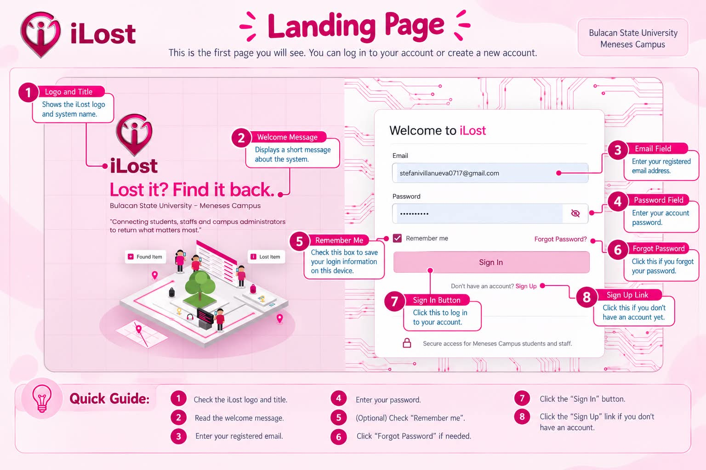
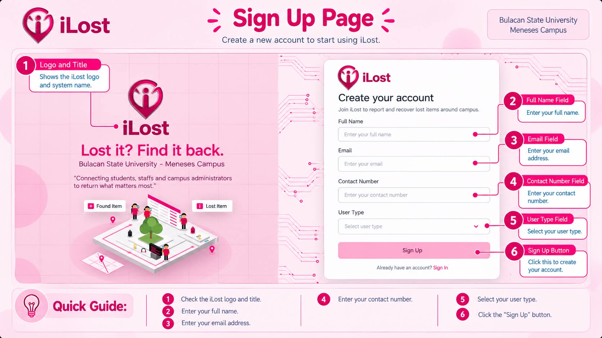
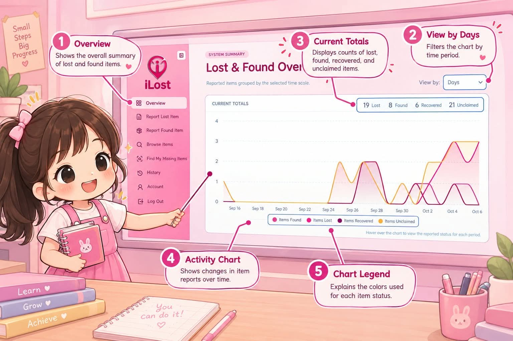
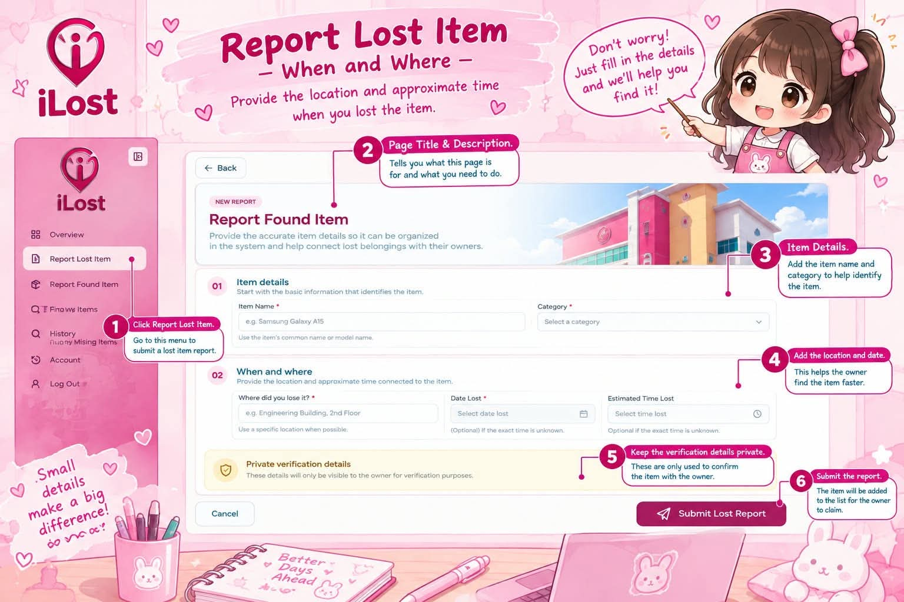
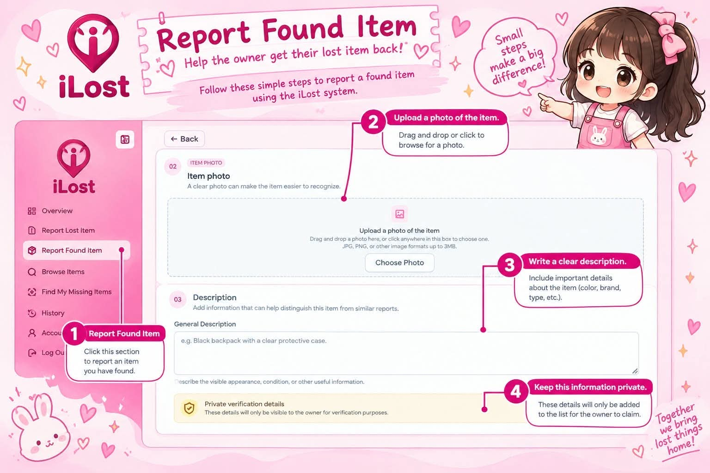
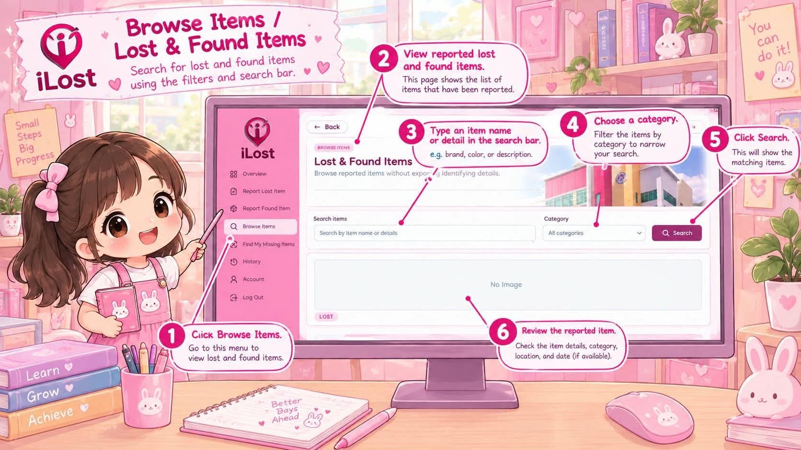
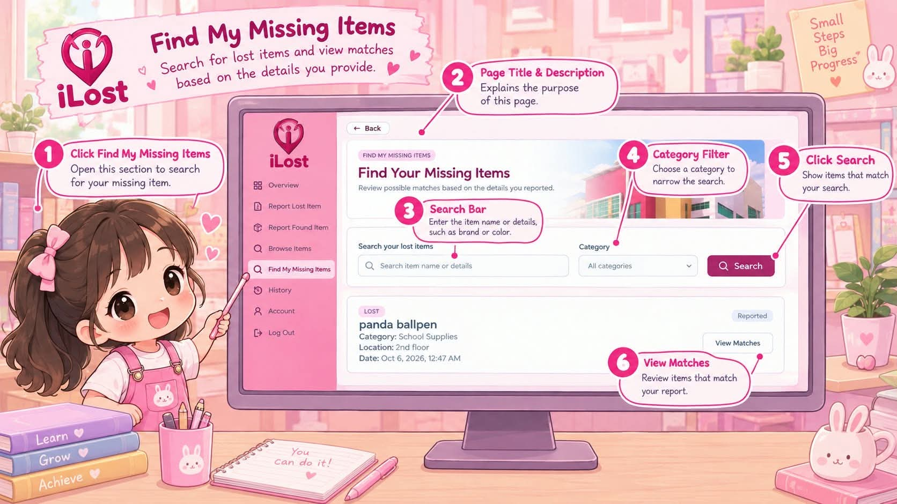
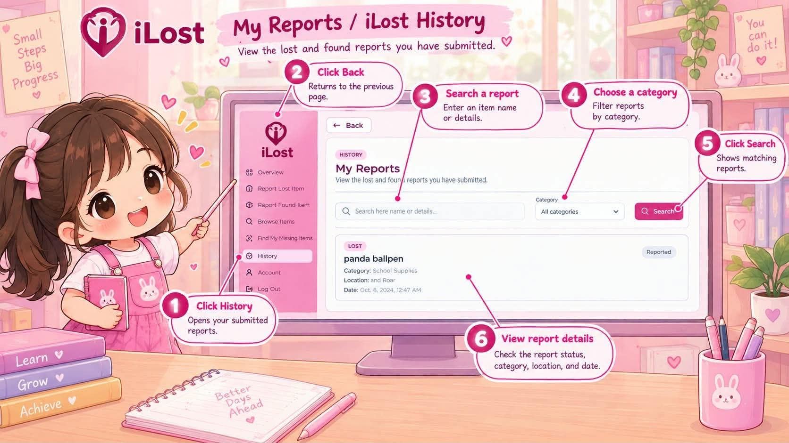
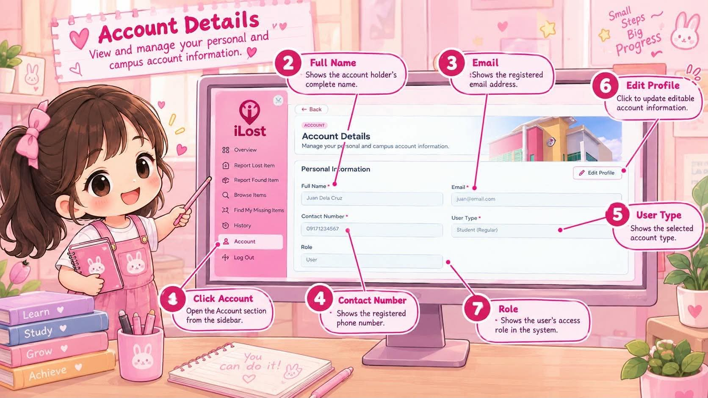

# iLost User Manual

## A Web-Based Lost and Found Reporting, Matching, and Claim Verification System

**Bulacan State University – Meneses Campus**

*Lost it? Find it back.*

---

## Table of Contents

1. Introduction
2. Accessing the System
3. Creating an Account
4. Logging In
5. Understanding the Dashboard
6. Reporting a Lost Item
7. Reporting a Found Item
8. Browsing and Searching Items
9. Finding Possible Matches
10. Submitting a Claim
11. Viewing History
12. Managing Account Information
13. Logging Out
14. Live Testing Notes

---

## 1. Introduction

This manual explains how to use the iLost Lost and Found Management System of Bulacan State University – Meneses Campus. It covers account access, lost and found reports, item search, possible matches, claims, history, and account information.

The instructions describe the behavior identified through application code inspection. They do not confirm that email delivery, database operations, matching results, or claim review have been tested in a live environment.

## 2. Accessing the System

The landing page provides the sign-in form and links to registration and password recovery.

1. Open the iLost system in a web browser.
2. On the landing page, enter your email address and password.
3. Optionally select **Remember me** or use the password visibility control.
4. Select **Sign In** to submit your credentials.
5. To create an account, select **Sign Up**. To request a password reset, select **Forgot Password?**

The sign-in form requires an email address and password. The email field uses browser email-format validation. The application displays an error if authentication fails or account information cannot be loaded. A successful sign-in directs a regular user to the dashboard and an administrator to the administrator dashboard.

The landing page includes a **Remember me** checkbox, but the inspected sign-in code does not use its value to change session behavior. Do not rely on it to keep a session active.

**Screenshot 1 — Landing Page / Login**

## 3. Creating an Account

1. On the landing page, select **Sign Up**.
2. Enter your **Full Name**, **Email**, and **Contact Number**.
3. Select a **User Type**: Student, Faculty, or Staff.
4. If you selected Student, enter your **Program**, select your **Year Level**, and enter your **Section**.
5. Enter a **Password** and re-enter it in **Confirm Password**. Use the visibility controls if needed.
6. Select **Create Account** and review the confirmation prompt.
7. Select **Create Account** in the prompt to submit the registration.
8. Follow any confirmation instructions displayed by the application. If email confirmation is required, check your inbox before trying to sign in. The registration page may offer **Resend Confirmation Email** after a confirmation-needed response; the control has a 60-second cooldown.
9. Select **Sign In** to return to the landing page.

All displayed registration fields are required, including the student fields when Student is selected. The email field uses browser email validation. Passwords must match and be at least six characters long. The application reports registration errors and displays a success or confirmation-needed message after its request returns.

**Screenshot 2 — Registration**

## 4. Logging In

1. On the landing page, enter your registered email address.
2. Enter your password. Use the visibility control if you want to check the entered text.
3. Optionally select **Remember me**.
4. Select **Sign In**.
5. If the credentials are accepted and the profile loads, continue to the appropriate dashboard.

Both fields are required, and the email field uses browser email validation. The application displays an error when sign-in or profile loading fails. Selecting **Forgot Password?** opens the password recovery form, while **Sign Up** opens registration.

To recover a password, select **Forgot Password?**, enter the email address associated with the account, and select **Send Reset Link**. If a reset email arrives, follow its instructions. On the reset form, enter and confirm a new password of at least six characters. The passwords must match. Email delivery and redirect behavior still need live testing.

## 5. Understanding the Dashboard

The regular-user dashboard displays a welcome message, shortcuts to report lost or found items, a system summary, and the navigation sidebar.

1. Select **Report Lost Item** or **Report Found Item** to open the corresponding report form.
2. Use the sidebar to open **Overview**, **Report Lost Item**, **Report Found Item**, **Browse Items**, **Find My Missing Items**, **History**, or **Account**.
3. In the **Lost & Found Overview** chart, use **View by** to select Days, Weeks, or Months.
4. Hover over the chart to view the displayed information for a period.
5. Use the sidebar toggle to expand or collapse the navigation. On smaller screens, navigation collapses after a selection.

The summary displays totals for lost, found, recovered, and unclaimed items. In the inspected code, “recovered” counts items with a `returned` status, while “unclaimed” counts all items not marked `returned`. The chart and totals depend on data returned by the backend.

**Screenshot 3 — Dashboard**

## 6. Reporting a Lost Item

1. From the dashboard or sidebar, select **Report Lost Item**.
2. Enter the **Item Name**, select a **Category** and **Subcategory**, and provide the item details requested for that selection. Brand, model, color, and size appear only for applicable categories and subcategories.
3. Optionally add an **Item Photo**. Choose a file or drag and drop it into the photo area. Use **Change Photo** or **Remove Photo** if needed.
4. Optionally enter a **General Description** and **Distinctive Details**.
5. Enter **Where did you lose it?**, select **Date Lost**, and optionally select **Estimated Time Lost**.
6. Select the submit button and review the confirmation prompt.
7. Confirm to submit the report, or select **Cancel** to leave without submitting.

Item name, category, subcategory, and location are marked required. The date is also presented as required, and the calendar disables future dates. However, because the date picker is a custom control, test that an empty date is rejected before relying on that requirement.

Time, photo, brand/model/color/size where shown, description, and distinctive details are optional in the inspected form. Photos must be image files and no larger than 5 MB.

If the backend accepts the report, the code records it as a lost item with `reported` status, displays a success message, clears the form, and returns to the dashboard. Upload or report errors are displayed. These outcomes have not been verified against a live backend.

**Screenshot 4 — Report Lost Item**

## 7. Reporting a Found Item

1. From the dashboard or sidebar, select **Report Found Item**.
2. Enter the **Item Name**, select a **Category** and **Subcategory**, and complete the applicable item details. Brand, model, color, and size depend on the selected category and subcategory.
3. Optionally add a photo by choosing or dragging and dropping an image. Use **Change Photo** or **Remove Photo** if necessary.
4. Optionally enter a **General Description** and **Distinctive Details**.
5. Enter **Where did you find it?**, select **Date Found**, and optionally select **Estimated Time Found**.
6. Select the submit button and review the confirmation prompt.
7. Confirm to submit the report, or select **Cancel** to leave without submitting.

The required fields, photo limits, optional fields, and future-date handling are the same as for a lost report. The date is marked required in the form, but because it uses a custom calendar control, test that an empty date is rejected.

The code inserts a found-item report with `reported` status. If the backend accepts it, the application displays success, clears the form, and returns to the dashboard. Live persistence has not been confirmed.

**Screenshot 5 — Report Found Item**

## 8. Browsing and Searching Items

1. Select **Browse Items** from the sidebar.
2. Review the lost and found item cards. The page is designed to display items without exposing identifying details.
3. To filter the list, enter a search term in **Search items** and/or choose a **Category**.
4. Select **Search**. Leave the search text blank and the category set to **All categories** to display the unfiltered list.
5. If no results match, try another search term or category.

Search is case-insensitive and checks available item details such as item name, category, type, status, and other loaded fields. The cards show the lost/found type, category, and an image when available. The application provides loading, error, empty-list, and no-search-results messages. Actual items and image availability depend on backend access and have not been live-tested.

**Screenshot 6 — Browse Items**

## 9. Finding Possible Matches

1. Select **Find My Missing Items** from the sidebar.
2. Review your reported lost items. If the list is empty, report the lost item first.
3. Optionally search your lost-item list by entering a term and/or choosing a category, then selecting **Search**.
4. Select **View Matches** on the lost item you want to check.
5. Review the possible found-item matches and their match-level labels.
6. Select **Back** to return to the previous matching view or choose another lost item.

The code compares your lost item with found reports whose status is `reported`. Category and subcategory are the main comparison fields. Matching both can produce Possible, Likely, or Strong Match results depending on supporting brand, model, color, and size information. Matching only one core field can produce a Less Possible Match. Items that match neither category nor subcategory are excluded.

Matching is an automated comparison, not proof of ownership. The usefulness and accuracy of the results have not been verified with live data.

**Screenshot 7 — Find My Missing Items**

## 10. Submitting a Claim

1. Open **Find My Missing Items** and select **View Matches** for a lost-item report.
2. On a possible found-item match, select **Submit Claim**. If you have already submitted a claim for that item, the page displays the existing claim status instead.
3. Complete **Why do you believe this is your item?**, **Where did you lose it?**, **When did you lose it?**, and **Private identifying details**.
4. Optionally enter **Additional information**.
5. Select **Submit Claim** and review the confirmation prompt.
6. Confirm to send the claim, or select **Cancel** to close the form without submitting.

The four claim fields are required. The code checks that the required text fields are not blank and that a date is supplied. Additional information is optional.

If the backend accepts the claim, it is submitted with `pending` status and the page displays that it is pending verification. A duplicate claim is reported as an error. A pending status means the claim awaits review; it does not mean that ownership has been verified or that the item has been returned.

## 11. Viewing History

1. Select **History** from the sidebar.
2. Review your item reports and any approved or completed claims included in the list.
3. To filter the list, enter a search term and/or select a category, then select **Search**.
4. Review each entry's type, item name, status, category, location, date, and time when available.

The inspected history query includes the signed-in user's reports and claims with `approved` or `completed` status; pending claims are not included. The page sorts entries newest first and provides loading, empty, error, and no-results messages.

Database access rules can restrict claim details, and the page may indicate that a claim-access migration is needed. Confirm history and claim visibility against the live database.

**Screenshot 8 — History**

## 12. Managing Account Information

1. Select **Account** from the sidebar.
2. Review your personal information and campus information.
3. Select **Edit Profile** to enable editing.
4. Update **Full Name**, **Contact Number**, **Program**, **Year Level**, and/or **Section** as needed.
5. Select **Save Changes** to submit the changes. The application requires a non-blank full name.
6. To discard edits, select **Cancel**. The displayed fields return to their previously loaded values.

Email, User Type, Role, and Account Created are read-only. The application displays a success message and updated values if the backend accepts the update; otherwise, it displays an error. Confirm saved changes persist by checking the account again after a reload.

**Screenshot 9 — Account / Edit Profile**

## 13. Logging Out

1. Select **Log Out** in the sidebar or on the Account page.
2. In the confirmation dialog, select **Log Out** to confirm or **Cancel** to remain signed in.
3. After a successful sign-out, the application returns to the landing page.

The Account-page logout path displays an error if sign-out fails. The sidebar logout path calls sign-out and returns to the landing page but does not check or display a sign-out error in the inspected code. Test both paths and confirm that the session is actually cleared.

## 14. Live Testing Notes

The following behaviors require testing in the deployed application. They should not be presented as confirmed results based only on source inspection.

1. Whether registration confirmation emails and password reset emails are delivered, and whether their links return users to the correct screens.
2. Whether registration, sign-in, password updates, reports, photos, claims, and account changes are accepted and persisted by the configured backend.
3. Whether reporting forms reject a missing date. The date field is presented as required, but it uses a custom picker.
4. Whether browse results, match candidates, images, history entries, and claim details are available under the deployed database and storage access policies.
5. Whether possible-match rankings are useful with real reports and whether administrators can review and update claims.
6. Whether logout clears the active session reliably, particularly when using the sidebar logout control.
